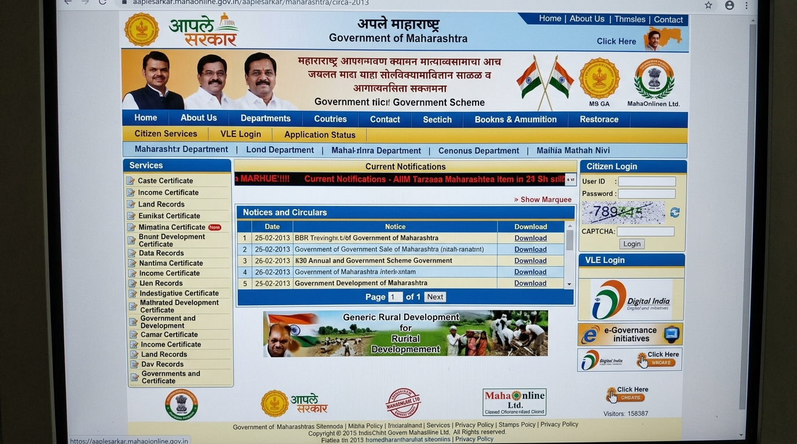
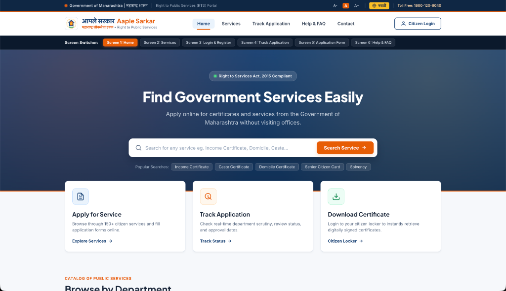

# Aaple Sarkar 2.0 — Maharashtra Citizen Public Services Portal

> **Human-Machine Interaction (HMI) — Practical 8 Project**  
> **Topic:** Computing the Complexity of Graphical User Interface and Redesigning it for Minimizing Screen Complexity and Cognitive Entropy.  
> **Institute:** Fr. Conceiçao Rodrigues College of Engineering (CRCE), Bandra  
> **Department:** Department of Computer Engineering  
> **Team:** Jeet Chavan (10584), Sanika Lobo (10613), Yash Masaye (10617), Meet Mangaonkar (10616)

---

## 📌 Executive Summary

**Aaple Sarkar** (`aaplesarkar.mahaonline.gov.in`) is the official public service delivery gateway initiated by the **Government of Maharashtra** under the **Right to Public Services (RTS) Act, 2015**. It empowers over 11 crore citizens to access statutory certificates and documents (Income, Domicile, Caste, Land Records, Senior Citizen Cards) online.

However, the existing portal suffers from severe information overload, fragmented navigation, and high visual entropy. In this project, we analyzed the portal using **Tullis' Screen Complexity Model** and **Bonsiepe's Information Entropy**, and engineered a task-focused, fully responsive **6-screen redesigned interface**.

---

## 🖼️ UI Comparison: Before vs. After

### 🔴 Before: Legacy Portal Interface (`aaplesarkar.mahaonline.gov.in`)
*3 stacked navigation ribbons, chaotic 3-column layout, premature CAPTCHA on homepage, and banner images eating >45% above-the-fold space.*



---

### 🟢 After: Redesigned Aaple Sarkar 2.0 Interface
*Unified sticky header, 12-column grid alignment, prominent search hero with saffron action button, 3 quick action cards, and progressive disclosure.*



---

## 📊 Quantitative UI & Time Complexity Changes

Using **Tullis’ Measure of Screen Layout Complexity** ($C_{\text{alignment}} = C_h + C_v$) and empirical visual search formulas:

$$T \approx k_1 + k_2\log_2(N) + k_3(C_h + C_v)$$

| Metric / Parameter | Existing Legacy Portal (`mahaonline.gov.in`) | Redesigned Portal (Aaple Sarkar 2.0) | Quantitative Improvement |
| :--- | :---: | :---: | :---: |
| **Total Visual Elements ($N$)** | **148** distinct items | **34** cohesive elements | **🔻 77.0% reduction** |
| **Vertical Alignment Lines ($C_v$)** | **31** ragged column axes | **6** strict grid axes | **🔻 80.6% reduction** |
| **Horizontal Alignment Lines ($C_h$)** | **42** staggered baselines | **8** unified horizontal rows | **🔻 80.9% reduction** |
| **Total Alignment Complexity ($C_h + C_v$)** | **73 alignment points** | **14 alignment points** | **🔻 80.8% lower entropy** |
| **Estimated Visual Search Time ($T$)** | **≈ 3.42 seconds** | **≈ 0.94 seconds** | **⚡ 72.5% faster search** |
| **Navigation Layers** | 3 stacked bars | 1 sticky header + mobile drawer | **🔻 66.7% fewer tiers** |
| **Homepage Choice Overload (Hick’s Law)** | 48 competing unorganized links | 5 clear actions + 1 search box | **🔻 87.5% link clutter** |
| **CAPTCHA Cognitive Interruption** | Mandatory immediately on homepage | Deferred inside authentication modal | **Zero upfront friction** |

---

## 🔄 Direct Architectural & Functional Redesign

| UI Component | Previous UI Flaws | Redesigned Solution | HMI Principle Applied |
| :--- | :--- | :--- | :--- |
| **Page Layout** | Chaotic 3-column layout with unaligned widget heights | Single-column breathing layout with generous whitespace | **Law of Proximity & Simplicity** |
| **Header & Nav** | 3 separate bars, duplicate emblems, outdated text | 1 sticky header with bilingual labels + mobile off-canvas drawer | **Fitts's Law & Visual Hierarchy** |
| **Search & Discovery** | Hidden behind nested menus and scrolling lists | Prominent hero search with popular keyword pills | **Primary Action Dominance** |
| **Service Catalog** | Auto-scrolling marquee tickers and long unstyled tables | Interactive card grid with SLA delivery timelines & doc badges | **User Control & Freedom** |
| **Authentication** | Crammed right sidebar with separate reset buttons | Segmented Citizen vs. VLE toggle + single unified recovery modal | **Error Prevention & Aesthetics** |
| **Application Tracking** | Text input buried amidst circulars and notices | Dedicated tracking screen with 4-stage visual timeline stepper | **Visibility of System Status** |
| **Application Form** | Disorienting multi-page redirects with unannounced doc rules | 3-step wizard with pre-application document checklist | **Miller’s Law ($7 \pm 2$) & Chunking** |
| **Accessibility** | Fixed font sizes, outdated browser warnings | `A- / A / A+` font scaler, English/Marathi switch, WCAG 2.1 AA | **Universal Accessibility** |

---

## 🖥️ 6 Task-Focused Screens Included

1. **Screen 1: Citizen Homepage** — Hero search, quick-action cards (*Apply*, *Track*, *Download*), and department service pills.
2. **Screen 2: All Services Catalog** — 13 essential certificates (Income, Domicile, Caste, Non-Creamy Layer, 7/12 Land Record, Solvency, etc.) with SLA timelines.
3. **Screen 3: Citizen & VLE Authentication** — Clean login card, role toggle, deferred CAPTCHA verification, and OTP password recovery.
4. **Screen 4: Track Application** — Real-time tracking ID query with demo test cases and interactive 4-milestone timeline stepper.
5. **Screen 5: Multi-Step Application Wizard** — Personal details $\to$ Document upload (with DigiLocker fetch) $\to$ Review & ₹23.60 statutory fee receipt.
6. **Screen 6: Help & Support** — Categorized accordion FAQ and 24/7 toll-free helpline card (`1800-120-8040`).

---

## 📱 Responsive & Mobile-Ready Design

- **Mobile Off-Canvas Navigation Drawer**: Accessible hamburger menu with smooth slide animations and backdrop blur.
- **Adaptive Layouts**: Responsive breakpoints for Desktop (1440px), Laptop (1024px), Tablet (768px), and Mobile (480px / 360px).
- **Touch-Friendly Targets**: Minimum 44px touch targets on mobile viewports for easy thumb navigation.

---

## 🚀 How to Run Locally

Clone the repository and open the project in any modern browser:

```bash
# Clone the repository
git clone https://github.com/Jeetchavan02/Aaple-Sarkar.git

# Navigate to project directory
cd Aaple-Sarkar

# Open directly in browser or start a local server
python3 -m http.server 8000
```

Open `http://localhost:8000` to interact with all 6 redesigned screens.
